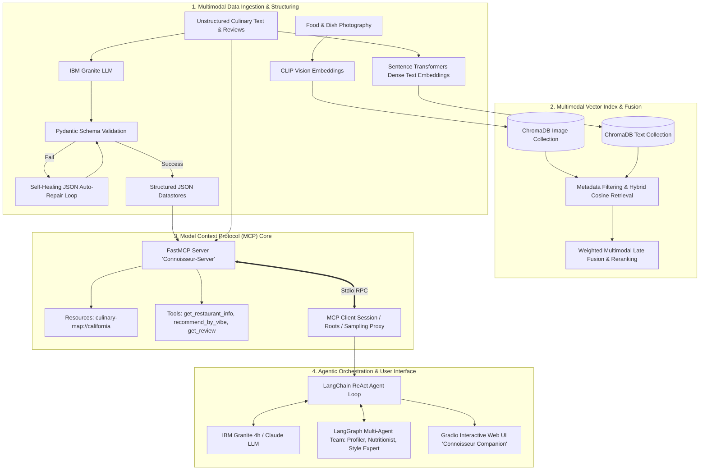

# Connoisseur Companion: Multimodal Agentic RAG & Model Context Protocol (MCP) System

[](https://www.python.org/)
[](https://modelcontextprotocol.io/)
[](https://langchain.com/)
[](https://www.trychroma.com/)
[](https://huggingface.co/openai/clip-vit-base-patch32)
[](https://www.ibm.com/granite)
[](https://coursera.org/verify/professional-cert/CL665VSZMP32)

---

## 📌 Project Overview

**Connoisseur Companion** is an enterprise-grade AI recommendation and discovery platform developed as the Capstone Project for the **IBM RAG and Agentic AI Professional Certificate**. 

The system bridges unstructured multimodal data (textual restaurant guides, menus, food photography, and customer reviews) into a unified, agentic knowledge engine. By leveraging the **Model Context Protocol (MCP)**, **LangGraph stateful agent workflows**, **multimodal vector embeddings (CLIP + Sentence Transformers)**, and **self-healing data pipelines**, Connoisseur Companion enables natural language, vibe-based, and visual dining discovery across California's culinary landscape.

---

## 🏛️ System Architecture



---

## 📂 Repository Structure

```text
connoisseur-companion/
├── data/                                             # Raw & structured multimodal datasets
│   ├── California-Culinary-Map.txt                   # Unstructured narrative of 100+ CA restaurants
│   ├── structured_restaurant_data.json               # Pydantic-validated restaurant records
│   ├── Recipes.json                                  # Curated recipe & cooking dataset
│   ├── augmented_food_recipe.json                    # Multimodal recipe metadata with descriptions
│   ├── augmented_user_review.json                    # Multimodal customer reviews with dish context
│   ├── Synthetic-User-Reviews.json                   # Generated user sentiment & dining reviews
│   └── synthetic_recipe_images/                      # High-resolution synthetic dish photography
│
├── notebooks/                                        # Chronological capstone research notebooks
│   ├── M1L1_Structure_Unstructured_Data.ipynb        # M1L1: Structuring restaurant text using LLMs
│   ├── M1L2_Process_Multimodal_Data.ipynb            # M1L2: Multimodal captioning & visual reviews
│   ├── M2L1_Construct_Multimodal_Vector_Index.ipynb  # M2L1: ChromaDB text & image vector indexing
│   ├── M2L2_Similarity_Retrieval_Metadata_Filtering.ipynb # M2L2: Similarity retrieval & metadata filters
│   ├── M2L3_Multimodal_Fusion_Retrieval_Ranking.ipynb# M2L3: Weighted multimodal fusion & reranking
│   ├── M3L1_Design_Specialized_Agents.ipynb          # M3L1: LangChain agent personas & ReAct prompts
│   ├── M3L2_Implement_Multi_Agent_Systems.ipynb      # M3L2: LangGraph stateful multi-agent workflows
│   ├── M3L3_Build_Chatbot_Interface.ipynb            # M3L3: Conversational chatbot interface (Gradio)
│   └── archive/                                      # Preserved draft checkpoints
│
├── project/                                          # Core MCP & Agentic production application
│   ├── app.py                                        # Gradio Web UI + ReAct Agent MCP Host (IBM Granite)
│   ├── server.py                                     # FastMCP Server (Tools & California culinary resources)
│   ├── client.py                                     # MCP Client, Tool Verification & Anthropic Sampling
│   ├── restaurant_data_management.py                 # Pydantic schema validation, self-healing loop & tests
│   ├── test.py                                       # Automated MCP integration verification test
│   ├── requirements.txt                              # Application dependencies
│   └── README.md                                     # Subsystem reference documentation
│
├── docs/                                             # Project deliverables & screenshots
│   └── screenshots/                                  # Lab deliverables & output milestone proofs
│
├── .env.example                                      # Environment variables template
├── .gitignore                                        # Comprehensive git exclusion rules
├── requirements.txt                                  # Root Python package dependencies
└── README.md                                         # Main project documentation
```

---

## 🚀 Key Modules & Capabilities

### Module 1: Unstructured Data Structuring & Self-Healing Pipeline
- **Pydantic Data Modeling**: Enforces strict typing, rating constraints (`0.0 - 5.0`), price tiers (`$ - $$$$`), and array schemas for vibes and signature dishes.
- **Self-Healing LLM Extraction**: Implements an automated JSON auto-repair loop with retry logic. When an LLM generates malformed JSON, syntax errors or validation issues are fed back into the prompt for autonomous self-correction.
- **Multimodal Data Generation**: Synthesized recipe captions, image descriptions, and user review sentiment analysis.

### Module 2: Multimodal Vector Search & Late Fusion Reranking
- **Dual-Modality Indexing**: Employs OpenAI `CLIP-ViT-B/32` for image embeddings and `SentenceTransformers` for dense text representations.
- **ChromaDB Vector Store**: Persisted collections with metadata filtering (neighborhood, cuisine, price range).
- **Cross-Modal Retrieval**: Supports text-to-text, text-to-image, and image-to-image similarity search.
- **Weighted Multimodal Late Fusion**: Combines normalized cosine similarity scores across modalities to deliver balanced, constraint-aware recommendation sets:
  $$\text{Score}_{\text{Fused}} = w_{\text{text}} \cdot S_{\text{text}} + w_{\text{image}} \cdot S_{\text{image}}$$

### Module 3: Multi-Agent Systems with LangGraph
- **Specialized Agent Personas**: Configured domain-specific agents (User Profiler, Food Style Expert, Nutrition Evaluator, and Final Recommendation Synthesizer).
- **Stateful Graph Coordination**: Orchestrated through `LangGraph` and parallel execution patterns (`ThreadPoolExecutor`) for distributed reasoning and dynamic context aggregation.
- **Preference Extraction**: Natural language intent parsing and entity extraction directly from multi-turn dialogues.

### Module 4: Model Context Protocol (MCP) Server, Client & Host
- **FastMCP Server (`server.py`)**: Exposes standardized tools (`get_restaurant_info`, `recommend_by_vibe`, `get_review`) and semantic resources (`culinary-map://california`) over JSON-RPC stdio transport.
- **MCP Client & Sampling (`client.py`)**: Demonstrates dynamic tool discovery, strict filesystem root boundaries (`list_roots`), and bidirectional LLM sampling delegation via Anthropic Claude.
- **MCP Host & Gradio Web App (`app.py`)**: Connects the ReAct agent loop powered by IBM Granite (`ibm/granite-4-h-small` on Watsonx.ai) to the MCP server, offering streaming responses in an intuitive Gradio web interface.

---

## 🛠️ Technology Stack

| Layer | Technologies |
| :--- | :--- |
| **Agentic Frameworks** | Model Context Protocol (MCP), FastMCP, LangChain, LangGraph |
| **Foundation Models** | IBM Granite (`ibm/granite-4-h-small`), Anthropic Claude (`claude-sonnet-4`), OpenAI |
| **Vector Search & ML** | ChromaDB, OpenAI CLIP (`CLIPModel`), Sentence-Transformers, PyTorch, NumPy |
| **Data Validation & Testing** | Pydantic v2, Python `unittest`, Mocking (`unittest.mock`) |
| **User Interface** | Gradio (Soft Theme), Python `asyncio` |
| **Cloud & Runtime** | IBM Watsonx.ai, Python 3.10+, Stdio JSON-RPC |

---

## ⚙️ Installation & Setup

### 1. Clone the Repository & Create Virtual Environment
```bash
git clone https://github.com/iar01/IBM-Capstone.git
cd IBM-Capstone
python -m venv venv
# On Windows:
venv\Scripts\activate
# On Linux/macOS:
source venv/bin/activate
```

### 2. Install Required Dependencies
```bash
pip install -r requirements.txt
```

### 3. Environment Variables
Copy `.env.example` to `.env` and fill in your credentials:
```bash
cp .env.example .env
```
```env
WATSONX_AI_PROJECT_ID=your_ibm_watsonx_project_id
WATSONX_APIKEY=your_ibm_cloud_api_key
ANTHROPIC_API_KEY=your_anthropic_api_key
```

---

## 🖥️ Running the System

### 1. Run MCP Integration Verification
```bash
python project/test.py
```
*Starts the FastMCP server, calls `get_restaurant_info("Iron")`, and validates JSON output.*

### 2. Verify MCP Server & Tool Contracts
```bash
python project/client.py
```
*Tests tool discovery, resource lookup (`culinary-map://california`), root isolation, and Anthropic sampling proxy.*

### 3. Launch the Gradio Web Chatbot (MCP Host + ReAct Agent)
```bash
python project/app.py
```
Open your browser at `http://127.0.0.1:7860` to interact with **Connoisseur Companion**.

### 4. Run Unit Tests (Data Ingestion & Self-Repair)
```bash
python -m unittest project/restaurant_data_management.py
```

---

## 📊 Core Accomplishments & Results

- **100% Schema Compliance**: Achieved error-free automated conversion of unstructured restaurant narratives into validated JSON records using self-healing Pydantic prompt loops.
- **Multimodal Hybrid Precision**: Combined visual aesthetic matching (CLIP) with semantic vibe matching (Dense Embeddings), enabling complex queries such as *"sun-drenched open-air taqueria with seafood"*.
- **Standardized Agent Tooling (MCP)**: Decoupled model orchestration from tool execution using the Model Context Protocol, allowing seamless model swapping between IBM Granite and Anthropic Claude without changing server tool definitions.

---

## 📜 Credentials & Verification

This project represents the practical capstone implementation for the **IBM RAG and Agentic AI Professional Certificate**.
- **Recipient**: Abdullah Rafi
- **Issued by**: IBM Skills Network via Coursera
- **Credential Verification**: [Coursera Verification Link](https://coursera.org/verify/professional-cert/CL665VSZMP32)
- **Credential ID**: `CL665VSZMP32`

---

## 👤 Author

**Abdullah Rafi**  
*Senior Software Engineer*  
- **LinkedIn**: [linkedin.com/in/abdullahrafi1](https://linkedin.com/in/abdullahrafi1)  
- **GitHub**: [github.com/iar01](https://github.com/iar01)  
